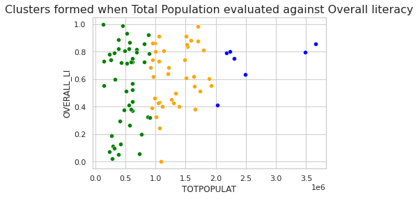
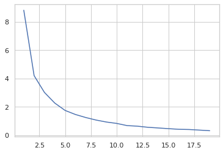
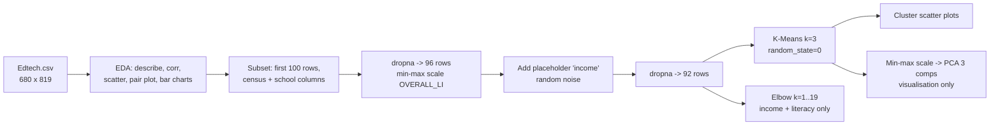
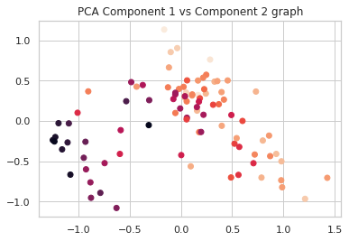

# EdTech Market Segmentation (District-level, India)

**Exploratory K-Means segmentation (k = 3) of 92 Indian districts on census and school-education indicators, a first pass at choosing where an EdTech product should launch.**

[](https://github.com/Akshatb848/Market-Segmentation-for-Edtech-Startups/actions/workflows/ci.yml)
[](LICENSE)
[](https://www.python.org/downloads/)


## Results at a glance

| What | Value (from the notebook outputs) |
|---|---|
| Districts loaded | 680 rows × 819 columns (2015-16, district-wise) |
| Districts clustered | 92 (first 100 rows in file order, i.e. Jammu & Kashmir through Delhi, after `dropna()`) |
| Features | Census indicators, government and private school counts, scaled literacy and a placeholder `income` column (see Limitations). The PCA input is 92 × 31 and includes the row index and the cluster label. |
| Algorithm | `KMeans(n_clusters=3, random_state=0)`, elbow curve for k = 1–19, PCA (3 components) for visualisation |
| Quantitative cluster quality | Not computed (no silhouette / Davies-Bouldin score in the notebook) |

<p align="center">
  
  
</p>

*Left: the three K-Means clusters, plotted as total population (x) against min-max-scaled literacy (y). Right: the elbow curve (inertia vs. k). Both figures are taken unchanged from the notebook outputs.*

**Main takeaway.** The clusters split almost entirely by district population: roughly under 1 million, about 1 to 2 million, and over 2 million. Literacy is spread across all three. Features were not scaled before K-Means, so `TOTPOPULAT`, the column with by far the largest values, dominates the distance metric. In practice the segments are population bands. The notebook stops at exploration: it does not yet profile the segments or turn them into personas. [Next steps](#next-steps) covers what that would take.

## Business problem

An EdTech startup entering India has to decide which regions to target first. Districts vary widely in population, urbanisation, literacy and school infrastructure. Grouping districts with similar profiles would let each group get its own go-to-market approach, for example premium or self-serve in dense, highly literate districts and assisted or vernacular offerings elsewhere.

## Data

| | |
|---|---|
| Dataset | [Education in India (Kaggle, `rajanand/education-in-india`)](https://www.kaggle.com/datasets/rajanand/education-in-india), district-wise school-education statistics for 2015-16 |
| Licence | As stated on the Kaggle dataset page. Check it there before redistributing. The data is not included in this repo. |
| Shape | 680 rows × 819 columns (`float64`: 13, `int64`: 803, `object`: 3) |
| Columns used | Census: `TOTPOPULAT`, `P_URB_POP`, `POPULATION_0_6`, `GROWTHRATE`, `SEXRATIO`, `OVERALL_LI`, `FEMALE_LIT`, `MALE_LIT`, `P_SC_POP`, `P_ST_POP`. Schools: `SCH1G`–`SCH9G`, `SCH1P`–`SCH9P`, `SCHTOT`, `SCHTOTG`. |
| Setup | Download the 2015-16 district-wise CSV from the Kaggle page (it appears to be `2015_16_Districtwise.csv`), rename it to `Edtech.csv`, and put it next to the notebook. |

## Approach



1. **Exploration:** `describe()`, `corr()`, `info()`, null counts, population vs. growth-rate scatter plots, a pair plot, and bar charts of schools, population and literacy by state.
2. **Subset:** the first 100 rows (state codes 1–7) and the census and school columns. 96 rows remain after `dropna()`.
3. **Features:** `OVERALL_LI` is min-max scaled. An `income` column is added from `tf.random.normal`. **This is unseeded random noise used as a placeholder, not real income data.** 92 districts remain after a further `dropna()`.
4. **Clustering:** `KMeans(n_clusters=3, random_state=0)` is fitted on all remaining numeric columns, including the row `index` column, **without scaling**. The two later cells that refit K-Means for the other scatter plots reuse the same frame, which by then also holds the previous cluster label (`cluter`).
5. **Elbow:** inertia for k = 1–19, computed on `income` and `OVERALL_LI` only.
6. **PCA:** the 92 × 31 matrix, which includes the cluster label, is min-max scaled and projected to 3 components for plotting. PCA is not an input to clustering.

<details>
<summary>PCA projection (components 1 vs 2, coloured by literacy)</summary>


</details>

## Reproduce

The notebook was last executed in 2022 under Python 3.8.10. The dependencies in `requirements.txt` install and import on Python 3.11, and CI checks this on every push.

```bash
git clone https://github.com/Akshatb848/Market-Segmentation-for-Edtech-Startups.git
cd Market-Segmentation-for-Edtech-Startups
python3.11 -m venv .venv && source .venv/bin/activate   # Windows: .venv\Scripts\activate
pip install -r requirements.txt
# put Edtech.csv next to the notebook (see Data)
jupyter notebook EdTechMarketSegmentation.ipynb
```

Run the cells top to bottom. Some cells were written for older library versions. With current pandas or seaborn, `df.corr()` on a frame with text columns, positional `sns.barplot(x, y)` and `sns.distplot` raise errors or deprecation warnings. Either use `df.corr(numeric_only=True)` and `sns.barplot(x=..., y=...)`, or install `"pandas<2" "seaborn<0.12"` on Python 3.8–3.10.

Smoke checks (no data needed). These are the same checks CI runs:

```bash
pip install pytest nbformat
pytest -q tests
```

## Repository structure

```
.
├── EdTechMarketSegmentation.ipynb   # EDA, preprocessing, K-Means, elbow, PCA (with saved outputs)
├── docs/images/                     # figures extracted from the notebook outputs
├── tests/test_notebooks.py          # CI smoke checks: nbformat validity + README numbers match notebook outputs
├── requirements.txt
├── .github/workflows/ci.yml
└── LICENSE
```

## Limitations

- **`income` is synthetic.** It is unseeded random noise, so any pattern that involves it, including the elbow curve, has no real-world meaning and changes on every run.
- **One feature dominates through scale.** K-Means ran on unscaled features, so population counts dominate the distance and the clusters reflect district size.
- **Coverage is partial.** Only 92 of 680 districts (7 northern states and UTs) are clustered.
- **There is leakage into PCA.** The cluster label and the row index are part of the matrix passed to PCA.
- **Data quality.** Some rows look misaligned. For example, New Delhi's `P_URB_POP` equals its `GROWTHRATE` (−25.35). One `TOTPOPULAT` value is divided by 10 by hand (row 18), but only after the clustering frame was built, so it does not change the clusters.
- **There is no quantitative validation.** No silhouette score, stability check or cluster profile is computed.
- **Reproducibility.** Cells were run partly out of order (execution count 36 is missing).

## Next steps

1. Use all 680 districts. Drop the placeholder `income` column, or replace it with a real proxy (for example, district GDP or night-lights data).
2. Choose features deliberately, such as literacy, urbanisation, child population share, and schools per 1,000 children. Standardise them, then pick k with silhouette and Davies-Bouldin scores alongside the elbow.
3. Profile each cluster (medians, top districts, a map) and turn the clusters into named segments with a go-to-market hypothesis for each.
4. Wrap preprocessing and K-Means in a scikit-learn `Pipeline` with a fixed seed, and export the district-to-segment mapping as a CSV.

## License

Code: [MIT](LICENSE) © 2026 Akshat Banga. The dataset is not redistributed here, and the licence on its Kaggle page applies.

## Author

**Akshat Banga**, AI Generalist and AI transformation. [GitHub](https://github.com/Akshatb848) · [LinkedIn](https://www.linkedin.com/in/akshat-banga-6574aa170/)
